# MODELO RELACIONAL DE LA BASE DE DATOS

## Sistema de Gestión de Roles y Turnos Hospitalarios

> **Reconciliado contra el esquema real el 2026-07-06** (consulta directa a `sys.tables`/`sys.columns`/`sys.foreign_keys`/`sys.check_constraints` sobre la base de desarrollo, no solo lectura de migraciones). Este documento había quedado desactualizado desde la migración `009` en adelante; ver `docs/database/decisiones-tecnicas.md §24` para el detalle de la reconciliación. A partir de ahora, cualquier migración nueva que cambie el esquema debe actualizar también este archivo en el mismo cambio (`ARQUITECTURA.md` §6).

---

# 1. Objetivo

Este documento presenta el modelo relacional de la base de datos del Sistema de Gestión de Roles y Turnos Hospitalarios. Su propósito es servir como referencia estructural para implementación backend, definición de migraciones, construcción de entidades ORM y validación técnica del diseño.

El modelo está orientado a:

* soportar planificación mensual por servicio o por departamento
* permitir múltiples turnos por día por persona
* separar tipos de día y turnos operativos
* registrar cambios, observaciones y trazabilidad (incluido un historial inmutable al cerrar una planificación)
* mantener escalabilidad y consistencia relacional

---

# 2. Convenciones del Modelo

## 2.1 Convenciones de claves

* Todas las tablas usan `id` como clave primaria técnica de tipo `BIGINT`
* Las claves foráneas se nombran con el patrón `id_<tabla_relacionada>`
* Los catálogos críticos usan `codigo` como identificador funcional único

## 2.2 Convenciones de auditoría

Las tablas maestras y transaccionales incluyen, según corresponda:

* `created_at`
* `updated_at`
* `created_by` / `updated_by` (solo en `rol_turno`; el resto de tablas transaccionales usa `id_usuario_*` con nombre específico según el evento)

## 2.3 Convenciones operativas

* `INCIDENCIA_PERSONAL` y `TURNO` son mutuamente excluyentes por fila en `ROL_TURNO`
* `ROL_TURNO` soporta multi-turno mediante `secuencia_dia`
* `TURNO` y `PLANIFICACION` pertenecen exactamente a un `SERVICIO` **o** a un `DEPARTAMENTO`, nunca a ambos ni a ninguno (patrón "scope XOR", aplicado también en `CONFIGURACION_OPERATIVA_SERVICIO`)
* `ASIGNACION_PERSONAL` es la entidad operativa intermedia entre persona y su contexto organizativo

## 2.4 Convenciones de tipos reales (SQL Server 2008 R2 compatible)

El motor real usa tipos SQL Server concretos, no los tipos genéricos que aparecían en versiones anteriores de este documento:

* `BOOLEAN` → `BIT`
* `TIMESTAMP`/`DATE` → `DATETIME` (ver `docs/database/compatibilidad-sql-server-2008-r2.md`; excepción puntual: `tipo_feriado.created_at/updated_at` y `feriado.created_at/updated_at` usan `DATETIME2`, una desviación menor y aislada, no el patrón general)
* `TEXT` → `NVARCHAR(n)` de longitud acotada, o `NVARCHAR(MAX)`/`VARCHAR(MAX)` cuando el campo lo requiere
* `TURNO.hora_inicio`/`hora_fin` y `TURNO_TRAMO.hora_inicio`/`hora_fin` → `CHAR(5)` en formato `HH:MM` (no `TIME`), validado con `CHECK ... LIKE`

---

# 3. Diagrama Relacional General

```mermaid
erDiagram
    DEPARTAMENTO ||--o{ SERVICIO : agrupa

    NIVEL_CARGO ||--o{ PERSONAL : clasifica
    DEPARTAMENTO ||--o{ ASIGNACION_PERSONAL : encuadra
    PERSONAL ||--o{ ASIGNACION_PERSONAL : posee
    TIPO_CONTRATO ||--o{ ASIGNACION_PERSONAL : aplica
    CARGA_HORARIA ||--o{ ASIGNACION_PERSONAL : clasifica
    ROL_FUNCIONAL ||--o{ ASIGNACION_PERSONAL : responsabiliza
    SERVICIO ||--o{ ASIGNACION_PERSONAL : asigna
    ASIGNACION_PERSONAL ||--o{ HISTORIAL_ASIGNACION : registra

    ROL_SEGURIDAD ||--o{ USUARIO : define
    PERSONAL ||--o| USUARIO : vincula
    USUARIO ||--o{ SESION_USUARIO : autentica

    SERVICIO ||--o{ TURNO : define
    DEPARTAMENTO ||--o{ TURNO : define
    TURNO ||--o{ TURNO_TRAMO : divide

    SERVICIO ||--o{ PLANIFICACION : planifica
    DEPARTAMENTO ||--o{ PLANIFICACION : planifica

    SERVICIO ||--o{ CONFIGURACION_OPERATIVA_SERVICIO : configura
    DEPARTAMENTO ||--o{ CONFIGURACION_OPERATIVA_SERVICIO : configura
    CONFIGURACION_OPERATIVA_SERVICIO ||--o{ CODIGO_OPERATIVO_SERVICIO : define
    TURNO ||--o{ CODIGO_OPERATIVO_SERVICIO : etiqueta
    INCIDENCIA_PERSONAL ||--o{ CODIGO_OPERATIVO_SERVICIO : etiqueta

    CALENDARIO ||--o{ ROL_TURNO : fecha
    CALENDARIO ||--o| TIPO_FERIADO : clasifica
    PLANIFICACION ||--o{ ROL_TURNO : contiene
    ASIGNACION_PERSONAL ||--o{ ROL_TURNO : programa
    TURNO ||--o{ ROL_TURNO : asigna
    INCIDENCIA_PERSONAL ||--o{ ROL_TURNO : marca

    PLANIFICACION ||--o{ OBSERVACION_MENSUAL : consolida
    ASIGNACION_PERSONAL ||--o{ OBSERVACION_MENSUAL : afecta

    PLANIFICACION ||--o| PLANIFICACION_HISTORIAL : "materializa al cerrar"
    PLANIFICACION_HISTORIAL ||--o{ ROL_TURNO_HISTORIAL : snapshot
    PLANIFICACION_HISTORIAL ||--o{ OBSERVACION_HISTORIAL : snapshot
    PLANIFICACION_HISTORIAL ||--o{ OBSERVACION_MENSUAL_HISTORIAL : snapshot
```

> `CAMBIO_TURNO` (migración `006`) se eliminó mediante la migración `040_drop_cambio_turno.sql`
> (2026-07-06): nunca tuvo implementación de aplicación (sin entidad, repositorio, caso de uso,
> controlador ni endpoint, y ninguna otra tabla la referenciaba por FK). Ver
> `docs/database/decisiones-tecnicas.md`.
>
> `PLANTILLA_PLANIFICACION`, `COBERTURA_TURNO`, `REGLA_HORAS` y `OBSERVACION` (observación diaria
> por celda) se eliminaron mediante la migración
> `041_drop_plantilla_cobertura_reglahoras_observaciondiaria.sql` (2026-07-06): decisión del usuario
> de recortar el modelo al alcance actual (planificar el rol mensual por servicio/departamento). Las
> cuatro tenían implementación de aplicación real pero sin datos cargados y sin uso desde el
> frontend; `duplicar planificación` (que reutilizaba el mismo motor de copia de `rol_turno` que
> `plantilla_planificacion`) se conservó, ahora como método propio de `RolTurnoRepository`. Ver
> `docs/database/decisiones-tecnicas.md §29`.

---

# 4. Diccionario Relacional por Tabla

## 4.1 ORGANIZACIÓN

### DEPARTAMENTO

**Clave primaria**

* `id`

**Atributos**

| Campo | Tipo | Nulo | Clave | Descripción |
| --- | --- | --- | --- | --- |
| id | BIGINT | No | PK | Identificador del departamento |
| codigo | VARCHAR(30) | No | UK | Código institucional único |
| nombre | NVARCHAR(300) | No | UK | Nombre del departamento |
| descripcion | NVARCHAR(1000) | Sí | - | Descripción funcional |
| activo | BIT | No | - | Estado lógico |
| created_at | DATETIME | No | - | Fecha de creación |
| updated_at | DATETIME | No | - | Fecha de actualización |

**Restricciones**

* `PK(id)`
* `UNIQUE(codigo)` (`uq_departamento_codigo`)
* `UNIQUE(nombre)` (`uq_departamento_nombre`) — ya aplicado, no solo recomendado

### SERVICIO

**Clave primaria**

* `id`

**Claves foráneas**

* `id_departamento -> DEPARTAMENTO.id`

**Atributos**

| Campo | Tipo | Nulo | Clave | Descripción |
| --- | --- | --- | --- | --- |
| id | BIGINT | No | PK | Identificador del servicio |
| id_departamento | BIGINT | No | FK | Departamento relacionado |
| codigo | VARCHAR(30) | No | UK | Código institucional |
| nombre | NVARCHAR(300) | No | - | Nombre del servicio |
| descripcion | NVARCHAR(1000) | Sí | - | Descripción funcional |
| activo | BIT | No | - | Estado lógico |
| created_at | DATETIME | No | - | Fecha de creación |
| updated_at | DATETIME | No | - | Fecha de actualización |

**Restricciones**

* `PK(id)`
* `FK(id_departamento) REFERENCES DEPARTAMENTO(id)`
* `UNIQUE(codigo)` (`uq_servicio_codigo`)
* `UNIQUE(id_departamento, nombre)` (`uq_servicio_departamento_nombre`) — ya aplicado

**Nota histórica:** este documento describía una tabla `FAMILIA_LABORAL` y una relación `SERVICIO_FAMILIA_HABILITADA` entre servicios y familias laborales, y `SERVICIO` llegó a tener una columna `id_familia_laboral` transitoriamente (migración `025`). Todo eso se eliminó en la migración `028_remove_familia_laboral.sql` (2026-07-03) — el concepto de familia laboral no forma parte del modelo vigente.

---

## 4.2 PERSONAL

### NIVEL_CARGO

**Clave primaria**

* `id`

| Campo | Tipo | Nulo | Clave | Descripción |
| --- | --- | --- | --- | --- |
| id | BIGINT | No | PK | Identificador del cargo |
| codigo | VARCHAR(30) | No | UK | Código del cargo |
| nombre | NVARCHAR(240) | No | UK | Nombre del cargo |
| descripcion | NVARCHAR(1000) | Sí | - | Descripción funcional |
| activo | BIT | No | - | Estado lógico |
| created_at | DATETIME | No | - | Fecha de creación |
| updated_at | DATETIME | No | - | Fecha de actualización |
| orden_visual | SMALLINT | Sí | - | Orden de presentación (migración `024`) |

**Restricciones**

* `PK(id)`
* `UNIQUE(codigo)`, `UNIQUE(nombre)` — ya aplicados

**Nota histórica:** la FK `id_familia_laboral -> FAMILIA_LABORAL.id` (antes obligatoria, luego opcional desde la migración `027`) se eliminó por completo en la migración `028`. `NIVEL_CARGO` ya no depende de ningún concepto de familia laboral.

### TIPO_CONTRATO

**Clave primaria**

* `id`

| Campo | Tipo | Nulo | Clave | Descripción |
| --- | --- | --- | --- | --- |
| id | BIGINT | No | PK | Identificador del tipo de contrato |
| codigo | VARCHAR(30) | No | UK | Código del tipo de contrato |
| nombre | NVARCHAR(240) | No | UK | Nombre del tipo de contrato |
| descripcion | NVARCHAR(1000) | Sí | - | Descripción funcional |
| activo | BIT | No | - | Estado lógico |
| created_at | DATETIME | No | - | Fecha de creación |
| updated_at | DATETIME | No | - | Fecha de actualización |

**Restricciones**

* `PK(id)` (nombre físico de la constraint: `pk_tipo_item`, artefacto histórico del rename)
* `UNIQUE(codigo)`, `UNIQUE(nombre)` — ya aplicados

**Nota histórica importante:** esta tabla es el resultado de la migración `032_rename_tipo_item_to_tipo_contrato.sql` (2026-07-03), que **eliminó la tabla `TIPO_CONTRATO` original** y **renombró `TIPO_ITEM` a `TIPO_CONTRATO`**. Antes existían dos tablas separadas (`TIPO_CONTRATO` y `TIPO_ITEM`) y `ASIGNACION_PERSONAL`/`REGLA_HORAS` tenían FKs a ambas; hoy solo existe esta tabla única, referenciada como `id_tipo_contrato`. Los nombres físicos de las constraints (`pk_tipo_item`, `uq_tipo_item_codigo`, `uq_tipo_item_nombre`) no se renombraron y siguen diciendo "tipo_item" — no indica un bug, es cosmético.

### CARGA_HORARIA

**Clave primaria**

* `id`

| Campo | Tipo | Nulo | Clave | Descripción |
| --- | --- | --- | --- | --- |
| id | BIGINT | No | PK | Identificador de la carga horaria |
| codigo | VARCHAR(30) | No | UK | Código visible de la carga horaria (`TC`, `MT`) |
| nombre | NVARCHAR(240) | No | - | Nombre funcional |
| horas_dia_base | DECIMAL(5,2) | No | - | Base diaria visible para el rol mensual |
| descripcion | VARCHAR(MAX) | Sí | - | Descripción operativa |
| activo | BIT | No | - | Estado lógico |
| created_at | DATETIME | No | - | Fecha de creación |
| updated_at | DATETIME | No | - | Fecha de actualización |

**Restricciones**

* `PK(id)`
* `UNIQUE(codigo)`

### ROL_FUNCIONAL

**Clave primaria**

* `id`

| Campo | Tipo | Nulo | Clave | Descripción |
| --- | --- | --- | --- | --- |
| id | BIGINT | No | PK | Identificador del rol funcional |
| codigo | VARCHAR(30) | No | UK | Código del rol funcional |
| nombre | NVARCHAR(240) | No | UK | Nombre de la función |
| alcance_organizativo | VARCHAR(20) | No | - | Alcance de la responsabilidad |
| es_jefatura | BIT | No | - | Marca de jefatura |
| descripcion | NVARCHAR(1000) | Sí | - | Descripción funcional |
| activo | BIT | No | - | Estado lógico |
| created_at | DATETIME | No | - | Fecha de creación |
| updated_at | DATETIME | No | - | Fecha de actualización |

**Restricciones**

* `PK(id)`
* `UNIQUE(codigo)`, `UNIQUE(nombre)`
* `CHECK(alcance_organizativo IN ('NINGUNO','SERVICIO','DEPARTAMENTO'))`

### PERSONAL

**Clave primaria**

* `id`

**Claves foráneas**

* `id_nivel_cargo -> NIVEL_CARGO.id`

| Campo | Tipo | Nulo | Clave | Descripción |
| --- | --- | --- | --- | --- |
| id | BIGINT | No | PK | Identificador del personal |
| codigo_personal | VARCHAR(30) | Sí | - | Código interno institucional |
| nombres | NVARCHAR(240) | No | - | Nombres |
| apellido_paterno | NVARCHAR(240) | No | - | Apellido paterno |
| apellido_materno | NVARCHAR(240) | Sí | - | Apellido materno |
| documento_identidad | VARCHAR(30) | No | - | Documento oficial |
| complemento_documento | VARCHAR(20) | Sí | - | Complemento documental |
| id_nivel_cargo | BIGINT | No | FK | Cargo actual |
| fecha_ingreso_institucion | DATETIME | Sí | - | Fecha de ingreso |
| activo | BIT | No | - | Estado lógico |
| created_at | DATETIME | No | - | Fecha de creación |
| updated_at | DATETIME | No | - | Fecha de actualización |

**Restricciones**

* `PK(id)`
* `FK(id_nivel_cargo) REFERENCES NIVEL_CARGO(id)`

### ASIGNACION_PERSONAL

**Clave primaria**

* `id`

**Claves foráneas**

* `id_personal -> PERSONAL.id`
* `id_servicio -> SERVICIO.id`
* `id_departamento -> DEPARTAMENTO.id`
* `id_tipo_contrato -> TIPO_CONTRATO.id`
* `id_carga_horaria -> CARGA_HORARIA.id`
* `id_rol_funcional -> ROL_FUNCIONAL.id`

| Campo | Tipo | Nulo | Clave | Descripción |
| --- | --- | --- | --- | --- |
| id | BIGINT | No | PK | Identificador de la asignación |
| id_personal | BIGINT | No | FK | Personal asignado |
| id_servicio | BIGINT | Sí | FK | Servicio asignado si aplica |
| id_departamento | BIGINT | Sí | FK | Departamento asignado si aplica |
| id_tipo_contrato | BIGINT | No | FK | Tipo de contrato/ítem vigente |
| id_rol_funcional | BIGINT | No | FK | Rol funcional en la asignación |
| nro_item | VARCHAR(50) | Sí | - | Número de ítem |
| codigo_fuente_item | VARCHAR(30) | Sí | - | Fuente administrativa o financiera |
| tipo_asignacion | VARCHAR(30) | No | - | `PRINCIPAL` o `SECUNDARIA` |
| es_principal | BIT | No | - | Marca de asignación principal |
| fecha_inicio | DATETIME | No | - | Inicio de vigencia |
| fecha_fin | DATETIME | Sí | - | Fin de vigencia |
| activo | BIT | No | - | Estado lógico |
| created_at | DATETIME | No | - | Fecha de creación |
| updated_at | DATETIME | No | - | Fecha de actualización |
| id_carga_horaria | BIGINT | Sí | FK | Carga horaria visible del Excel (migración `009`) |

**Restricciones**

* `PK(id)`
* `CHECK(fecha_fin IS NULL OR fecha_fin >= fecha_inicio)` (`ck_asignacion_personal_fechas`)
* `CHECK(tipo_asignacion IN ('PRINCIPAL','SECUNDARIA'))` (`ck_asignacion_personal_tipo`) — simplificado en la migración `031`; antes incluía también `ROTACION`, `COBERTURA`, `TEMPORAL`
* `CHECK(id_servicio IS NOT NULL OR id_departamento IS NOT NULL)` (`ck_asignacion_personal_ambito`)
* `UNIQUE(id_personal, id_servicio, id_departamento, fecha_inicio) WHERE activo = 1` (`uq_asignacion_personal_persona_ambito_inicio`)
* `UNIQUE(id_personal) WHERE activo = 1 AND es_principal = 1` (`ux_asignacion_personal_persona_principal_activa`)
* `UNIQUE(id_personal) WHERE tipo_asignacion = 'PRINCIPAL' AND activo = 1` (`uix_asignacion_personal_una_principal_activa`)

**Nota histórica:** ya no existen `id_tipo_item` como FK separada de `id_tipo_contrato` (fusionadas en la migración `032`) ni la compatibilidad con `FAMILIA_LABORAL`/`SERVICIO_FAMILIA_HABILITADA` (eliminada en la migración `028`).

### HISTORIAL_ASIGNACION

**Clave primaria**

* `id`

**Claves foráneas**

* `id_asignacion_personal -> ASIGNACION_PERSONAL.id`
* `id_servicio_origen -> SERVICIO.id`
* `id_servicio_destino -> SERVICIO.id`
* `id_departamento_origen -> DEPARTAMENTO.id`
* `id_departamento_destino -> DEPARTAMENTO.id`
* `id_usuario -> USUARIO.id`

| Campo | Tipo | Nulo | Clave | Descripción |
| --- | --- | --- | --- | --- |
| id | BIGINT | No | PK | Identificador del evento histórico |
| id_asignacion_personal | BIGINT | No | FK | Asignación afectada |
| fecha_evento | DATETIME | No | - | Fecha del evento |
| tipo_evento | VARCHAR(30) | No | - | Tipo de cambio |
| id_servicio_origen | BIGINT | Sí | FK | Servicio origen |
| id_servicio_destino | BIGINT | Sí | FK | Servicio destino |
| id_departamento_origen | BIGINT | Sí | FK | Departamento origen |
| id_departamento_destino | BIGINT | Sí | FK | Departamento destino |
| id_usuario | BIGINT | No | FK | Usuario responsable |
| motivo | NVARCHAR(1000) | Sí | - | Justificación |
| created_at | DATETIME | No | - | Fecha de registro |

**Restricciones**

* `PK(id)`
* `CHECK(tipo_evento IN ('ALTA','ACTUALIZACION','TRASLADO','CIERRE','REACTIVACION'))`

**Corrección:** versiones anteriores de este documento listaban columnas `id_tipo_contrato_origen`/`id_tipo_contrato_destino` en esta tabla — **no existen** en el esquema real, nunca se llegaron a crear.

---

## 4.3 SEGURIDAD

### ROL_SEGURIDAD

**Nota histórica:** esta tabla se llamaba `ROL` hasta la migración `042_rename_tipo_dia_and_rol.sql`
(2026-07-06) — el nombre colisionaba conceptualmente con "rol de turnos" (el nombre del sistema) y
con `ROL_TURNO`/`ROL_TURNO_HISTORIAL`. Los nombres físicos de constraints/índices/default
constraints (`pk_rol`, `uq_rol_codigo`, `ck_rol_alcance_planificacion`, `fk_usuario_rol`, `df_rol_*`)
no se renombraron — mismo criterio cosmético que otros renombres de este proyecto (ver `tipo_contrato`
en 4.2). Ver `docs/database/decisiones-tecnicas.md §30`.

**Clave primaria**

* `id`

| Campo | Tipo | Nulo | Clave | Descripción |
| --- | --- | --- | --- | --- |
| id | BIGINT | No | PK | Identificador del rol_seguridad |
| codigo | VARCHAR(30) | No | UK | Código del rol_seguridad |
| nombre | NVARCHAR(240) | No | - | Nombre del rol_seguridad |
| descripcion | NVARCHAR(1000) | Sí | - | Descripción funcional |
| activo | BIT | No | - | Estado lógico |
| created_at | DATETIME | No | - | Fecha de creación |
| updated_at | DATETIME | No | - | Fecha de actualización |
| alcance_planificacion | VARCHAR(20) | No | - | `SISTEMA` / `DEPARTAMENTO` / `SERVICIO` / `LECTURA` (migración `017`) |
| puede_ver_reportes | BIT | No | - | Ver reportes de personal por planificación (migración `039`) |

**Columnas de permisos** (todas `BIT NOT NULL`, agregadas en la migración `017`, más `puede_ver_reportes` en la `039`) — 34 columnas en total, no documentadas en versiones anteriores de este archivo:

`puede_ver_organizacion`, `puede_ver_personal`, `puede_gestionar_personal`, `puede_ver_asignaciones`, `puede_gestionar_asignaciones`, `puede_ver_seguridad`, `puede_gestionar_usuarios`, `puede_ver_operacion`, `puede_ver_planificacion`, `puede_editar_planificacion`, `puede_aprobar_planificacion`, `ver_calendarios`, `gestionar_calendarios`, `ver_incidencias_personales`, `gestionar_incidencias_personales` (renombradas desde `ver_tipos_dia`/`gestionar_tipos_dia` en la migración `043_rename_permisos_tipos_dia_columns.sql`, 2026-07-06), `gestionar_tipos_feriado`, `ver_tipos_turno` (siempre `0`, catálogo eliminado — ver 4.5), `ver_cargas_horarias`, `gestionar_cargas_horarias`, `ver_turnos`, `crear_planificacion`, `editar_planificacion`, `enviar_revision_planificacion`, `volver_borrador_planificacion`, `aprobar_planificacion`, `cerrar_planificacion`, `exportar_planificacion`, `exportar_planificacion_lote`, `gestionar_codigos_operativos`, `gestionar_turnos`, `gestionar_asignaciones`, `gestionar_servicios`, `gestionar_usuarios`, `puede_ver_reportes`.

Ver `docs/arquitectura/matriz-permisos-operativos.md` para el significado funcional de cada permiso por rol_seguridad.

**Restricciones**

* `PK(id)`
* `UNIQUE(codigo)`
* `CHECK(alcance_planificacion IN ('SISTEMA','DEPARTAMENTO','SERVICIO','LECTURA'))`

La migración `039_add_puede_ver_reportes_permission.sql` que agrega `puede_ver_reportes` ya está
enganchada en `database/run-migrations.sql` (corregido en la limpieza del 2026-07-06, ver
`docs/database/decisiones-tecnicas.md §27`).

### USUARIO

**Clave primaria**

* `id`

**Claves foráneas**

* `id_personal -> PERSONAL.id`
* `id_rol_seguridad -> ROL_SEGURIDAD.id`

| Campo | Tipo | Nulo | Clave | Descripción |
| --- | --- | --- | --- | --- |
| id | BIGINT | No | PK | Identificador del usuario |
| id_personal | BIGINT | Sí | FK | Personal vinculado |
| id_rol_seguridad | BIGINT | Sí | FK | Rol de seguridad local o fallback |
| tipo_usuario | VARCHAR(20) | No | - | Tipo de usuario conocido por el sistema |
| proveedor_autenticacion | VARCHAR(30) | No | - | Origen de autenticación |
| sujeto_autenticacion | VARCHAR(150) | Sí | - | Identificador estable del usuario en el proveedor externo |
| username | VARCHAR(80) | No | UK | Usuario de acceso |
| password_hash | VARCHAR(255) | Sí | - | Hash de contraseña local |
| ultimo_acceso_at | DATETIME | Sí | - | Último acceso |
| activo | BIT | No | - | Estado lógico |
| created_at | DATETIME | No | - | Fecha de creación |
| updated_at | DATETIME | No | - | Fecha de actualización |

**Restricciones**

* `PK(id)`
* `UNIQUE(username)`
* `CHECK(tipo_usuario IN ('PERSONAL','ADMINISTRATIVO','INTEGRACION'))`
* `CHECK(proveedor_autenticacion <> 'LOCAL' OR password_hash IS NOT NULL)` (`ck_usuario_password_local`) — ya aplicado, no solo recomendado

### SESION_USUARIO

Tabla no documentada en versiones anteriores de este archivo (migración `019_create_sesion_usuario.sql`).

**Clave primaria**

* `id`

**Claves foráneas**

* `id_usuario -> USUARIO.id`

| Campo | Tipo | Nulo | Clave | Descripción |
| --- | --- | --- | --- | --- |
| id | BIGINT | No | PK | Identificador de la sesión |
| id_usuario | BIGINT | No | FK | Usuario autenticado |
| token_hash | VARCHAR(128) | No | UK | Hash del token de sesión |
| ip_origen | VARCHAR(64) | Sí | - | IP de origen |
| user_agent | NVARCHAR(510) | Sí | - | User-Agent del cliente |
| last_seen_at | DATETIME | Sí | - | Última actividad |
| expires_at | DATETIME | Sí | - | Expiración de la sesión |
| revocada | BIT | No | - | Marca de revocación |
| revocada_at | DATETIME | Sí | - | Momento de revocación |
| motivo_revocacion | NVARCHAR(510) | Sí | - | Motivo de revocación |
| created_at | DATETIME | No | - | Fecha de creación |
| updated_at | DATETIME | No | - | Fecha de actualización |

**Restricciones**

* `PK(id)`
* `FK(id_usuario) REFERENCES USUARIO(id)`
* `UNIQUE(token_hash)`
* `UNIQUE(id_usuario) WHERE revocada = 0` — como máximo una sesión activa por usuario

### ESTRATEGIA FUTURA DE AUTENTICACIÓN

El modelo permite una transición desde autenticación local hacia autenticación federada o centralizada por microservicios si se respetan las siguientes decisiones:

* `USUARIO` debe entenderse como identidad local conocida por este sistema, no necesariamente como repositorio maestro de credenciales
* `proveedor_autenticacion` y `sujeto_autenticacion` permiten vincular la cuenta local con un servicio central de login
* `id_rol_seguridad` puede servir en la primera etapa como control local, pero a futuro puede actuar solo como perfil auxiliar o fallback
* la autorización crítica debería resolverse en tiempo de petición consultando el servicio central cuando ese componente exista

### GOBERNANZA FUNCIONAL DE ASIGNACIONES

| Rol | Solicita | Aprueba | Ejecuta cambios en `ASIGNACION_PERSONAL` | Observación |
| --- | --- | --- | --- | --- |
| `ADMIN_SISTEMA` | Sí | Sí | Sí | Uso excepcional y soporte operativo |
| `RRHH` | Sí | Sí | Sí | Rol principal para alta, traslado, cierre y reactivación |
| `JEFE_DEPARTAMENTO` | Sí | Sí | Sí, salvo cerrar/quitar | Ver `docs/arquitectura/matriz-permisos-operativos.md` — perdió la capacidad de cerrar/quitar asignaciones (decisión 2026-07-05) |
| `JEFE_SERVICIO` | Sí | No | No | Propone ingresos, salidas, coberturas y rotaciones |
| `PLANIFICADOR` | No | No | No | Solo usa asignaciones ya vigentes en planificación |

---

## 4.4 PLANIFICACIÓN

### CALENDARIO

**Clave primaria**

* `id`

| Campo | Tipo | Nulo | Clave | Descripción |
| --- | --- | --- | --- | --- |
| id | BIGINT | No | PK | Identificador del calendario |
| fecha | DATETIME | No | UK | Fecha exacta |
| anio | SMALLINT | No | - | Año |
| mes | SMALLINT | No | - | Mes |
| dia_mes | SMALLINT | No | - | Día del mes |
| dia_semana_num | SMALLINT | No | - | Día de la semana numérico |
| dia_semana_nombre | NVARCHAR(40) | No | - | Nombre del día |
| semana_mes | SMALLINT | Sí | - | Semana dentro del mes |
| es_fin_semana | BIT | No | - | Indica fin de semana |

**Restricciones**

* `PK(id)`
* `UNIQUE(fecha)`
* `CHECK(mes BETWEEN 1 AND 12)`, `CHECK(dia_mes BETWEEN 1 AND 31)`, `CHECK(dia_semana_num BETWEEN 1 AND 7)`, `CHECK(semana_mes IS NULL OR semana_mes BETWEEN 1 AND 6)`

Las columnas `es_feriado`/`codigo_feriado`/`nombre_feriado` (flags planas por día) se eliminaron en la
migración `049_calendario_feriado_relacional.sql` (2026-07-10, ver `decisiones-tecnicas.md` sección 58). Un
día es feriado si existe una fila activa en `FERIADO` cuyo rango `[fecha_inicio, fecha_fin]` cubre la fecha
— se resuelve por `LEFT JOIN` en tiempo de consulta, mismo patrón que `PLANIFICACION` ↔ `CALENDARIO` (sin FK
propia, unión por rango de fechas).

### FERIADO

Tabla nueva (migración `048_create_feriado.sql`, 2026-07-10). Un mes puede tener varios feriados (del mismo
tipo o de tipos distintos) y un feriado puede abarcar varios días consecutivos dentro de un único mes — algo
que las columnas planas de `CALENDARIO` no podían representar sin duplicar código/nombre por cada fila de
día. Ver `decisiones-tecnicas.md` sección 58 para el detalle completo de la decisión y la migración/backfill.

**Clave primaria**

* `id`

**Claves foráneas**

* `id_tipo_feriado -> TIPO_FERIADO.id`

| Campo | Tipo | Nulo | Clave | Descripción |
| --- | --- | --- | --- | --- |
| id | BIGINT | No | PK | Identificador del feriado |
| id_tipo_feriado | BIGINT | No | FK | Tipo de feriado (`TIPO_FERIADO`) |
| nombre | NVARCHAR(150) | No | - | Nombre del feriado (ej. "Año Nuevo") |
| anio | SMALLINT | No | - | Año al que pertenece |
| mes | SMALLINT | No | - | Mes al que pertenece |
| fecha_inicio | DATE | No | - | Primer día del rango |
| fecha_fin | DATE | No | - | Último día del rango |
| activo | BIT | No | - | Estado lógico (soft delete) |
| created_at | DATETIME2 | No | - | Fecha de creación |
| updated_at | DATETIME2 | No | - | Fecha de actualización |

**Restricciones**

* `PK(id)`
* `FK fk_feriado_tipo_feriado (id_tipo_feriado) -> TIPO_FERIADO.id`
* `CHECK ck_feriado_mes (mes BETWEEN 1 AND 12)`
* `CHECK ck_feriado_fechas (fecha_fin >= fecha_inicio)`
* `CHECK ck_feriado_pertenece_al_mes` — `YEAR`/`MONTH` de `fecha_inicio` y de `fecha_fin` deben coincidir con `anio`/`mes` (un feriado no puede cruzar de un mes a otro)
* Índice `ix_feriado_anio_mes` (filtrado `activo = 1`), índice `ix_feriado_id_tipo_feriado`
* Regla de negocio en aplicación (no en base): dos feriados activos no pueden superponerse en fechas (`TypeOrmFeriadoRepository.assertSinSuperposicion`) — devuelve `409 Conflict`

### PLANIFICACION

**Clave primaria**

* `id`

**Claves foráneas**

* `id_servicio -> SERVICIO.id`
* `id_departamento -> DEPARTAMENTO.id` (migración `026`)
* `id_usuario_creador -> USUARIO.id`
* `id_usuario_publicador -> USUARIO.id`
* `id_usuario_cierre -> USUARIO.id`

| Campo | Tipo | Nulo | Clave | Descripción |
| --- | --- | --- | --- | --- |
| id | BIGINT | No | PK | Identificador de la planificación |
| id_servicio | BIGINT | Sí | FK | Servicio planificado (nulo si es de alcance departamental, desde migración `026`) |
| anio | SMALLINT | No | - | Año de planificación |
| mes | SMALLINT | No | - | Mes de planificación |
| version | INT | No | - | Versión de la planificación |
| estado | VARCHAR(20) | No | - | `BORRADOR` / `REVISION` / `APROBADA` / `CERRADA` |
| fecha_inicio | DATETIME | No | - | Inicio del período |
| fecha_fin | DATETIME | No | - | Fin del período |
| id_usuario_creador | BIGINT | No | FK | Usuario creador |
| id_usuario_publicador | BIGINT | Sí | FK | Usuario publicador |
| fecha_publicacion | DATETIME | Sí | - | Momento de publicación |
| id_usuario_cierre | BIGINT | Sí | FK | Usuario de cierre |
| fecha_cierre | DATETIME | Sí | - | Momento de cierre |
| created_at | DATETIME | No | - | Fecha de creación |
| updated_at | DATETIME | No | - | Fecha de actualización |
| activo | BIT | No | - | Estado lógico (migración `010`) |
| id_departamento | BIGINT | Sí | FK | Departamento planificado si es de alcance departamental (migración `026`) |
| origen_cierre | VARCHAR(20) | Sí | - | `MANUAL` / `AUTOMATICO` (migración `036`) |

**Restricciones**

* `PK(id)`
* `CHECK(mes BETWEEN 1 AND 12)`, `CHECK(version >= 1)`, `CHECK(fecha_fin >= fecha_inicio)`
* `CHECK(estado IN ('BORRADOR','REVISION','APROBADA','CERRADA'))` — **no** `'PUBLICADO'`/`'CERRADO'` como decían versiones anteriores de este documento
* `CHECK(id_servicio IS NOT NULL OR id_departamento IS NOT NULL)` (`ck_planificacion_scope`)
* `CHECK(origen_cierre IS NULL OR origen_cierre IN ('AUTOMATICO','MANUAL'))`
* `UNIQUE(id_servicio, anio, mes, version) WHERE id_servicio IS NOT NULL`
* `UNIQUE(id_departamento, anio, mes, version) WHERE id_departamento IS NOT NULL`
* `UNIQUE(id_servicio, anio, mes) WHERE activo = 1 AND id_servicio IS NOT NULL` — una sola planificación activa por servicio y mes
* `UNIQUE(id_departamento, anio, mes) WHERE activo = 1 AND id_departamento IS NOT NULL` — ídem por departamento

**Nota histórica:** la columna `id_plantilla_planificacion` (y su FK a `PLANTILLA_PLANIFICACION`) se
eliminó en la migración `041` junto con la tabla — ver nota al inicio de la sección 4.

---

## 4.5 OPERACIÓN

### INCIDENCIA_PERSONAL

**Nota histórica:** esta tabla se llamaba `TIPO_DIA` hasta la migración `042_rename_tipo_dia_and_rol.sql`
(2026-07-06) — el nombre no describía bien el catálogo: sus filas son casi todas incidencias de
personal (`DESCANSO`, `VACACION`, `LICENCIA`, `BAJA_MEDICA`) más una fila de alcance `GENERAL`
(`FERIADO`) usada para marcar la celda de una persona puntual que no trabaja ese día. Los nombres
físicos de constraints/índices/default constraints (`pk_tipo_dia`, `uq_tipo_dia_codigo`,
`ck_tipo_dia_alcance`, `fk_rol_turno_tipo_dia`, `fk_codigo_operativo_servicio_tipo_dia`,
`ix_rol_turno_id_incidencia_personal`, `df_tipo_dia_*`) no se renombraron. Ver
`docs/database/decisiones-tecnicas.md §30`.

**Clave primaria**

* `id`

| Campo | Tipo | Nulo | Clave | Descripción |
| --- | --- | --- | --- | --- |
| id | BIGINT | No | PK | Identificador de la incidencia personal |
| codigo | VARCHAR(30) | No | UK | Código funcional |
| nombre | NVARCHAR(240) | No | - | Nombre de la incidencia personal |
| descripcion | NVARCHAR(1000) | Sí | - | Descripción operativa |
| alcance | VARCHAR(20) | No | - | `GENERAL` / `PERSONAL` / `OTRO` (migración `014`) |
| es_laborable | BIT | No | - | Marca de día laborable |
| genera_horas_trabajadas | BIT | No | - | Genera horas reales |
| computa_para_meta_horas | BIT | No | - | Impacta meta mensual |
| requiere_respaldo | BIT | No | - | Requiere respaldo documental |
| activo | BIT | No | - | Estado lógico |
| created_at | DATETIME | No | - | Fecha de creación |
| updated_at | DATETIME | No | - | Fecha de actualización |
| codigo_exportacion_etiqueta | VARCHAR(30) | Sí | - | Código para exportación en modo etiquetas (migración `011`) |
| codigo_exportacion_numerico | VARCHAR(30) | Sí | - | Código para exportación en modo numérico (migración `011`) |

**Restricciones**

* `PK(id)`
* `UNIQUE(codigo)`
* `CHECK(alcance IN ('GENERAL','PERSONAL','OTRO'))`

### TURNO

**Clave primaria**

* `id`

**Claves foráneas**

* `id_servicio -> SERVICIO.id`
* `id_departamento -> DEPARTAMENTO.id` (migración `035`)

| Campo | Tipo | Nulo | Clave | Descripción |
| --- | --- | --- | --- | --- |
| id | BIGINT | No | PK | Identificador del turno concreto |
| id_servicio | BIGINT | Sí | FK | Servicio al que pertenece (nulo si es de alcance departamental) |
| codigo | VARCHAR(30) | No | - | Código único dentro del servicio o departamento |
| nombre | NVARCHAR(240) | No | - | Nombre descriptivo |
| hora_inicio | CHAR(5) | No | - | Hora de inicio `HH:MM` (solo si `tipo_horario = 'CONTINUO'`) |
| hora_fin | CHAR(5) | No | - | Hora de fin `HH:MM` (solo si `tipo_horario = 'CONTINUO'`) |
| cruza_medianoche | BIT | No | - | Indica cruce de día |
| duracion_horas | DECIMAL(5,2) | No | - | Duración total |
| vigencia_desde | DATETIME | No | - | Inicio de vigencia |
| vigencia_hasta | DATETIME | Sí | - | Fin de vigencia |
| activo | BIT | No | - | Estado lógico |
| created_at | DATETIME | No | - | Fecha de creación |
| updated_at | DATETIME | No | - | Fecha de actualización |
| tipo_horario | VARCHAR(20) | No | - | `CONTINUO` / `DISCONTINUO` (migración `022`) |
| id_departamento | BIGINT | Sí | FK | Departamento al que pertenece si es de alcance departamental (migración `035`) |

**Restricciones**

* `PK(id)`
* `CHECK(id_servicio IS NOT NULL AND id_departamento IS NULL OR id_servicio IS NULL AND id_departamento IS NOT NULL)` (`ck_turno_scope_xor`)
* `CHECK(tipo_horario IN ('CONTINUO','DISCONTINUO'))`
* `CHECK(hora_inicio LIKE '[0-1][0-9]:[0-5][0-9]' OR hora_inicio LIKE '2[0-3]:[0-5][0-9]')` (y equivalente para `hora_fin`)
* `CHECK(duracion_horas > 0)`
* `CHECK(vigencia_hasta IS NULL OR vigencia_hasta >= vigencia_desde)`
* `UNIQUE(id_servicio, codigo, vigencia_desde) WHERE id_servicio IS NOT NULL`
* `UNIQUE(id_departamento, codigo, vigencia_desde) WHERE id_departamento IS NOT NULL`

**Eliminado (migración `033`):** la tabla `TIPO_TURNO` y la FK `TURNO.id_tipo_turno` ya no existen. No hay ningún catálogo conceptual global de tipos de turno; el código/etiqueta visual de un turno se resuelve hoy vía `CODIGO_OPERATIVO_SERVICIO` (ver más abajo).

### TURNO_TRAMO

Tabla no documentada en versiones anteriores de este archivo (migración `022_add_turno_tramo.sql`, "horario discontinuo").

**Clave primaria**

* `id`

**Claves foráneas**

* `id_turno -> TURNO.id`

| Campo | Tipo | Nulo | Clave | Descripción |
| --- | --- | --- | --- | --- |
| id | BIGINT | No | PK | Identificador del tramo |
| id_turno | BIGINT | No | FK | Turno al que pertenece (`tipo_horario = 'DISCONTINUO'`) |
| orden | SMALLINT | No | - | Orden del tramo dentro del turno |
| hora_inicio | CHAR(5) | No | - | Hora de inicio `HH:MM` |
| hora_fin | CHAR(5) | No | - | Hora de fin `HH:MM` |
| duracion_horas | DECIMAL(5,2) | No | - | Duración del tramo |
| cruza_medianoche | BIT | No | - | Indica cruce de día |
| activo | BIT | No | - | Estado lógico |

**Restricciones**

* `PK(id)`
* `FK(id_turno) REFERENCES TURNO(id)`
* `UNIQUE(id_turno, orden)`

### CONFIGURACION_OPERATIVA_SERVICIO

Tabla no documentada en versiones anteriores de este archivo (migración `013_create_configuracion_operativa_servicio.sql`, extendida en `030` y `034`).

**Clave primaria**

* `id`

**Claves foráneas**

* `id_servicio -> SERVICIO.id`
* `id_departamento -> DEPARTAMENTO.id` (migración `034`)

| Campo | Tipo | Nulo | Clave | Descripción |
| --- | --- | --- | --- | --- |
| id | BIGINT | No | PK | Identificador de la configuración |
| id_servicio | BIGINT | Sí | FK | Servicio configurado (nulo si es de alcance departamental) |
| modo_visual_default | VARCHAR(30) | No | - | `NUMERICO` / `ETIQUETAS` |
| permite_multi_registro_dia | BIT | No | - | Permite más de un registro por día |
| usa_equivalencia_horaria_exportacion | BIT | No | - | Habilita cálculo de equivalencia horaria en exportación |
| activo | BIT | No | - | Estado lógico |
| created_at | DATETIME | No | - | Fecha de creación |
| updated_at | DATETIME | No | - | Fecha de actualización |
| id_departamento | BIGINT | Sí | FK | Departamento configurado si es de alcance departamental (migración `034`) |

**Restricciones**

* `PK(id)`
* `CHECK(id_servicio IS NOT NULL AND id_departamento IS NULL OR id_servicio IS NULL AND id_departamento IS NOT NULL)`
* `CHECK(modo_visual_default IN ('NUMERICO','ETIQUETAS'))`
* `UNIQUE(id_servicio) WHERE id_servicio IS NOT NULL`, `UNIQUE(id_departamento) WHERE id_departamento IS NOT NULL`

**Nota:** tuvo una columna `agrupa_por_familia`, eliminada en la migración `030` junto con el resto de referencias a familia laboral.

### CODIGO_OPERATIVO_SERVICIO

Tabla no documentada en versiones anteriores de este archivo (migración `013`).

**Clave primaria**

* `id`

**Claves foráneas**

* `id_configuracion_operativa_servicio -> CONFIGURACION_OPERATIVA_SERVICIO.id`
* `id_turno -> TURNO.id`
* `id_incidencia_personal -> INCIDENCIA_PERSONAL.id`

| Campo | Tipo | Nulo | Clave | Descripción |
| --- | --- | --- | --- | --- |
| id | BIGINT | No | PK | Identificador del código |
| id_configuracion_operativa_servicio | BIGINT | No | FK | Configuración a la que pertenece |
| origen | VARCHAR(30) | No | - | `INCIDENCIA_PERSONAL` / `TURNO` |
| id_turno | BIGINT | Sí | FK | Turno de origen (solo si `origen = 'TURNO'`) |
| id_incidencia_personal | BIGINT | Sí | FK | Tipo de día de origen (solo si `origen = 'INCIDENCIA_PERSONAL'`) |
| codigo_visual | VARCHAR(30) | No | - | Código mostrado en la matriz/Excel |
| etiqueta | NVARCHAR(240) | No | - | Etiqueta descriptiva |
| descripcion | NVARCHAR(500) | Sí | - | Descripción operativa |
| horas_equivalentes | DECIMAL(5,2) | No | - | Horas equivalentes para exportación |
| categoria | VARCHAR(30) | No | - | `FERIADO` / `VACACION` / `LICENCIA` / `DESCANSO` / `TRABAJO` |
| color | VARCHAR(30) | Sí | - | Color operativo para la matriz/Excel |
| orden_visual | INT | No | - | Orden de presentación |
| es_laborable | BIT | No | - | Marca de día laborable |
| requiere_confirmacion | BIT | No | - | Requiere confirmación antes de aplicar |
| activo | BIT | No | - | Estado lógico |
| created_at | DATETIME | No | - | Fecha de creación |
| updated_at | DATETIME | No | - | Fecha de actualización |

**Restricciones**

* `PK(id)`
* `CHECK(origen IN ('INCIDENCIA_PERSONAL','TURNO'))`
* `CHECK((origen = 'TURNO' AND id_turno IS NOT NULL AND id_incidencia_personal IS NULL) OR (origen = 'INCIDENCIA_PERSONAL' AND id_turno IS NULL AND id_incidencia_personal IS NOT NULL))`
* `CHECK(categoria IN ('FERIADO','VACACION','LICENCIA','DESCANSO','TRABAJO'))`
* `CHECK(horas_equivalentes >= 0)`

### TIPO_FERIADO

Tabla no documentada en versiones anteriores de este archivo (migración `016_create_tipo_feriado.sql`).

**Clave primaria**

* `id`

| Campo | Tipo | Nulo | Clave | Descripción |
| --- | --- | --- | --- | --- |
| id | BIGINT | No | PK | Identificador del tipo de feriado |
| codigo | NVARCHAR(8) | No | UK | `FI` / `FR` / `FN` / `F` |
| nombre | NVARCHAR(160) | No | - | Nombre del tipo de feriado |
| descripcion | NVARCHAR(400) | Sí | - | Descripción |
| orden | SMALLINT | No | - | Orden de presentación |
| activo | BIT | No | - | Estado lógico |
| created_at | DATETIME2 | No | - | Fecha de creación (única tabla con `DATETIME2`, ver §2.4) |
| updated_at | DATETIME2 | No | - | Fecha de actualización |

**Restricciones**

* `PK(id)`
* `UNIQUE(codigo)`

El `CHECK(codigo IN ('FI','FR','FN','F'))` se eliminó en la migración `049_calendario_feriado_relacional.sql`
(2026-07-10): antes era la única forma de acotar los códigos válidos porque no existía relación real con
`CALENDARIO` (que duplicaba el mismo check por su lado). Ahora la tabla tiene una relación real: `FERIADO`
referencia `TIPO_FERIADO.id` por FK, y `codigo` es simplemente un campo libre y único del catálogo — ver
`decisiones-tecnicas.md` sección 58.

### ROL_TURNO

**Clave primaria**

* `id`

**Claves foráneas**

* `id_planificacion -> PLANIFICACION.id`
* `id_asignacion_personal -> ASIGNACION_PERSONAL.id`
* `id_calendario -> CALENDARIO.id`
* `id_turno -> TURNO.id`
* `id_incidencia_personal -> INCIDENCIA_PERSONAL.id`
* `created_by -> USUARIO.id`
* `updated_by -> USUARIO.id`

| Campo | Tipo | Nulo | Clave | Descripción |
| --- | --- | --- | --- | --- |
| id | BIGINT | No | PK | Identificador del registro operativo |
| id_planificacion | BIGINT | No | FK | Planificación relacionada |
| id_asignacion_personal | BIGINT | No | FK | Persona operativa asignada |
| id_calendario | BIGINT | No | FK | Día de calendario |
| secuencia_dia | SMALLINT | No | - | Secuencia del registro en el día |
| id_turno | BIGINT | Sí | FK | Turno concreto asignado |
| id_incidencia_personal | BIGINT | Sí | FK | Tipo de día asignado |
| horas_programadas | DECIMAL(5,2) | No | - | Horas imputadas al registro |
| origen_registro | VARCHAR(20) | No | - | `MANUAL` / `PLANTILLA` / `AJUSTE` / `CAMBIO` |
| created_by | BIGINT | No | FK | Usuario creador |
| created_at | DATETIME | No | - | Fecha de creación |
| updated_by | BIGINT | Sí | FK | Usuario modificador |
| updated_at | DATETIME | Sí | - | Fecha de modificación |

**Restricciones**

* `PK(id)`
* `CHECK(secuencia_dia >= 1)`, `CHECK(horas_programadas >= 0)`
* `CHECK(origen_registro IN ('MANUAL','PLANTILLA','AJUSTE','CAMBIO'))`
* `CHECK((id_turno IS NOT NULL AND id_incidencia_personal IS NULL) OR (id_turno IS NULL AND id_incidencia_personal IS NOT NULL))`
* `UNIQUE(id_planificacion, id_asignacion_personal, id_calendario, secuencia_dia)`

---

## 4.6 ELIMINADAS

### COBERTURA_TURNO, REGLA_HORAS y PLANTILLA_PLANIFICACION — ELIMINADAS (migración `041`)

Las tres existían (`cobertura_turno`/`regla_horas` con implementación real de validación operativa
al publicar/aprobar una planificación; `plantilla_planificacion` con CRUD completo para guardar y
cargar una planificación como plantilla) pero sin datos cargados y sin ningún uso desde el frontend
— se confirmó que las páginas nunca llamaban a esos endpoints. Se eliminaron por decisión del
usuario el 2026-07-06 junto con la columna `planificacion.id_plantilla_planificacion` y su FK. El
motor de copia de `rol_turno` que usaba internamente `plantilla_planificacion` (cargar los registros
de una planificación base hacia otra) se conservó porque también lo usa "duplicar planificación": hoy
vive como `RolTurnoRepository.copiarRegistrosDesdePlanificacionBase`. Ver
`database/migrations/041_drop_plantilla_cobertura_reglahoras_observaciondiaria.sql` y
`docs/database/decisiones-tecnicas.md §29`.

### CAMBIO_TURNO — ELIMINADA (migración `040`)

La tabla existía desde la migración `006` (índice agregado en `007`) pero **nunca tuvo
implementación de aplicación**: no había entidad de dominio, repositorio, caso de uso, controlador,
endpoint ni test en `apps/api/src`, y ninguna otra tabla la referenciaba mediante FK. Confirmado esto
el 2026-07-06 (ver `docs/database/decisiones-tecnicas.md §24`), se decidió eliminarla en vez de
mantener un esquema sin funcionalidad real — ver la migración `040_drop_cambio_turno.sql` y
`docs/database/decisiones-tecnicas.md §28`.

---

## 4.7 OBSERVACIONES

### OBSERVACION (diaria) — ELIMINADA (migración `041`)

Existía con implementación real (endpoint, caso de uso, repositorio) para registrar una observación
por celda del rol (persona + día), pero sin uso desde el frontend. Se eliminó el 2026-07-06 junto con
`plantilla_planificacion`, `cobertura_turno` y `regla_horas` — ver 4.6. `observacion_historial` (la
tabla que congela estas observaciones al cerrar una planificación) **no se eliminó**: sigue existiendo
en el esquema para planificaciones ya cerradas, aunque de aquí en adelante nunca se le agreguen filas
nuevas al no existir ya una fuente en vivo.

### OBSERVACION_MENSUAL

| Campo | Tipo | Nulo | Clave | Descripción |
| --- | --- | --- | --- | --- |
| id | BIGINT | No | PK | Identificador de la observación mensual |
| id_planificacion | BIGINT | No | FK | Planificación relacionada |
| id_asignacion_personal | BIGINT | No | FK | Persona relacionada |
| tipo_observacion | VARCHAR(30) | No | - | Clasificación funcional |
| descripcion | NVARCHAR(2000) | No | - | Observación mensual |
| created_by | BIGINT | No | FK | Usuario creador |
| created_at | DATETIME | No | - | Fecha de creación |

**Restricciones:** `PK(id)` + FKs hacia `PLANIFICACION`, `ASIGNACION_PERSONAL`, `USUARIO(created_by)`.

---

## 4.8 HISTORIAL INMUTABLE DE CIERRE (no documentado en versiones anteriores)

Introducido en las migraciones `036`-`038` (2026-07-04) para conservar una fotografía inmutable de una planificación al momento de cerrarse — ver `docs/database/decisiones-tecnicas.md §17`.

### PLANIFICACION_HISTORIAL

**Clave primaria:** `id`. **FK:** `id_planificacion -> PLANIFICACION.id` (único), `id_servicio -> SERVICIO.id`, `id_departamento -> DEPARTAMENTO.id`, `id_usuario_cierre -> USUARIO.id`.

| Campo | Tipo | Descripción |
| --- | --- | --- |
| id_planificacion | BIGINT | Planificación origen (`UNIQUE`) |
| anio, mes, version | SMALLINT/SMALLINT/INT | Periodo e identidad de versión al cerrar |
| id_servicio, codigo_servicio, nombre_servicio | BIGINT/VARCHAR(30)/NVARCHAR(240) | Snapshot del servicio (si aplica) |
| id_departamento, codigo_departamento, nombre_departamento | BIGINT/VARCHAR(30)/NVARCHAR(240) | Snapshot del departamento (si aplica) |
| estado_final | VARCHAR(20) | Siempre `'CERRADA'` |
| origen_cierre | VARCHAR(20) | `MANUAL` / `AUTOMATICO` |
| id_usuario_cierre, fecha_cierre | BIGINT/DATETIME | Quién y cuándo cerró |
| created_at | DATETIME | Fecha de materialización del historial |

**Restricciones:** `CHECK` scope XOR igual que `PLANIFICACION`; `CHECK(estado_final = 'CERRADA')`; `CHECK(origen_cierre IN ('AUTOMATICO','MANUAL'))`.

### ROL_TURNO_HISTORIAL, OBSERVACION_HISTORIAL, OBSERVACION_MENSUAL_HISTORIAL

Snapshots inmutables (denormalizados: nombre completo de la persona, código de turno/tipo de día, carga horaria, etc. congelados al momento del cierre) de `ROL_TURNO`, `OBSERVACION` y `OBSERVACION_MENSUAL` respectivamente, todos con FK a `PLANIFICACION_HISTORIAL.id`. `ROL_TURNO_HISTORIAL` es la más extensa (~40 columnas, ver migraciones `036`-`038` para el detalle completo) porque debe seguir siendo legible aunque las tablas vivas (`personal`, `turno`, `incidencia_personal`, `carga_horaria`) cambien después del cierre.

---

# 5. Resumen de Relaciones Clave

## 5.1 Relaciones organizativas

* Un `DEPARTAMENTO` tiene muchos `SERVICIO`
* Un `DEPARTAMENTO` puede tener muchas `ASIGNACION_PERSONAL`, `TURNO`, `PLANIFICACION` y `CONFIGURACION_OPERATIVA_SERVICIO` de alcance departamental
* Un `SERVICIO` tiene muchas `ASIGNACION_PERSONAL`, `TURNO` y `PLANIFICACION` cuando la adscripción incluye servicio

## 5.2 Relaciones de personal

* Un `PERSONAL` puede tener muchas `ASIGNACION_PERSONAL`
* Una `ASIGNACION_PERSONAL` puede tener muchos `ROL_TURNO` y `OBSERVACION_MENSUAL`
* Un `ROL_FUNCIONAL` puede participar en muchas `ASIGNACION_PERSONAL`

## 5.3 Relaciones operativas

* Una `PLANIFICACION` contiene muchos `ROL_TURNO`
* Un `ROL_TURNO` corresponde a un día de `CALENDARIO`
* Un `ROL_TURNO` referencia un `TURNO` o un `INCIDENCIA_PERSONAL`, nunca ambos
* Un `TURNO` puede tener muchos `TURNO_TRAMO` (solo si `tipo_horario = 'DISCONTINUO'`)
* Un `SERVICIO` o `DEPARTAMENTO` tiene a lo sumo una `CONFIGURACION_OPERATIVA_SERVICIO`, que a su vez agrupa muchos `CODIGO_OPERATIVO_SERVICIO`

## 5.4 Relaciones históricas

* Una `ASIGNACION_PERSONAL` puede registrar muchos `HISTORIAL_ASIGNACION`
* Una `PLANIFICACION` genera a lo sumo un `PLANIFICACION_HISTORIAL` al cerrarse, que a su vez agrupa muchos `ROL_TURNO_HISTORIAL`/`OBSERVACION_HISTORIAL`/`OBSERVACION_MENSUAL_HISTORIAL`

---

# 6. Restricciones Críticas del Modelo

* `ROL_TURNO` debe tener `id_turno` o `id_incidencia_personal`, pero no ambos
* `ROL_TURNO` debe ser único por planificación, asignación, día y secuencia
* `PLANIFICACION` debe ser única por (servicio o departamento), año, mes y versión — y tener alcance de servicio **o** de departamento, nunca ambos ni ninguno
* `TURNO` debe ser único por (servicio o departamento), código y vigencia de inicio — mismo patrón de alcance XOR que `PLANIFICACION`
* `ASIGNACION_PERSONAL` debe respetar coherencia temporal entre `fecha_inicio` y `fecha_fin`
* `ASIGNACION_PERSONAL` debe tener al menos servicio o departamento
* `CONFIGURACION_OPERATIVA_SERVICIO` y `CODIGO_OPERATIVO_SERVICIO` comparten el mismo patrón de alcance XOR (servicio/departamento) y de exclusión (turno/incidencia_personal) que `TURNO` y `ROL_TURNO`

---

# 7. Índices Recomendados

Los índices efectivamente creados por las migraciones (más allá de PK/UK, ya listados en cada tabla):

* `ux_asignacion_personal_persona_principal_activa`, `uix_asignacion_personal_una_principal_activa` (filtrados, ver 4.2)
* `ux_planificacion_servicio_anio_mes_activa`, `ux_planificacion_departamento_anio_mes_activa` (filtrados, ver 4.4)
* `uq_turno_servicio_codigo_vigencia`, `uq_turno_departamento_codigo_vigencia` (filtrados, ver 4.5)
* Índices de `sesion_usuario` sobre `token_hash` y `id_usuario` (filtrado por `revocada = 0`)

Para el detalle completo y exacto, la fuente de verdad son las migraciones `007_create_indices.sql` y las que agregan índices puntuales junto con cada cambio de esquema (`012`, `018`, `026`, `029`, `031`, `034`, `035`) — no se transcribe aquí una lista exhaustiva para evitar que este documento vuelva a desincronizarse.

---

# 8. Consideraciones de Implementación

## 8.1 Validaciones recomendadas en backend

Además de restricciones SQL, el backend debería validar (y en su mayoría ya valida, ver `apps/api/src/modules/*/application/use-cases/helpers/*-business-rules.ts` y `*-access-policy.service.ts`):

* que la autenticación local o externa entregue una identidad válida antes de cualquier operación protegida
* que el `USUARIO.id_rol_seguridad` tenga permiso para solicitar, aprobar o ejecutar cambios de asignación según la política definida
* coherencia entre el alcance (`servicio`/`departamento`) de `PLANIFICACION`, `ASIGNACION_PERSONAL` y `TURNO`
* no superposición indebida de asignaciones principales de una misma persona
* unicidad activa de `JEFE_SERVICIO` por servicio y `JEFE_DEPARTAMENTO` por departamento
* trazabilidad obligatoria en `HISTORIAL_ASIGNACION` para altas, actualizaciones, traslados, cierres y reactivaciones
* no coexistencia de `INCIDENCIA_PERSONAL` con otros registros del mismo día cuando el estado represente día completo
* cálculo de horas mensuales según reglas vigentes (nota: no hay un caso de uso dedicado a este cálculo en el backend actual — hallazgo de la auditoría de sincronización del 2026-07-06, informe ya retirado, ver `decisiones-tecnicas.md` §165)

## 8.2 Flujo recomendado de asignación

1. `JEFE_SERVICIO` o `JEFE_DEPARTAMENTO` registra la necesidad (alta, traslado, cobertura, reemplazo, designación de jefatura, cierre o reactivación).
2. `JEFE_DEPARTAMENTO` valida el impacto organizativo cuando corresponda.
3. `RRHH` revisa consistencia administrativa (cargo, tipo de contrato, vigencia, unicidad de jefaturas).
4. `RRHH` o `ADMIN_SISTEMA` ejecuta la modificación en `ASIGNACION_PERSONAL`.
5. El sistema registra la operación en `HISTORIAL_ASIGNACION` con el `id_usuario` responsable.
6. Solo las asignaciones vigentes con `id_servicio` quedan disponibles para `PLANIFICACION` y `ROL_TURNO`.

## 8.3 Motor de base de datos real

El motor real de desarrollo y producción es **SQL Server 2022** — misma versión en ambos entornos desde el 2026-07-08, cuando se abandonó el objetivo de compatibilidad con el SQL Server 2008 R2 del hospital (ver `docs/database/decisiones-tecnicas.md §36`; `docs/database/compatibilidad-sql-server-2008-r2.md` y las guías de VPN/migración a ese motor legado quedaron obsoletas por esa decisión). El diseño se mantiene deliberadamente portable (dominio desacoplado del motor, migraciones SQL explícitas, sin features específicas de un solo motor) pero PostgreSQL no es el motor real de este proyecto, a diferencia de lo que sugería una versión anterior de este documento.

---

# 9. Conclusión

Este modelo relacional define una base consistente, normalizada y trazable para gestionar roles y turnos hospitalarios. La versión anterior de este documento (previa a 2026-07-06) describía el diseño **original** de las migraciones `001`-`008`; 30 migraciones después, varias tablas cambiaron de forma sustancial (fusión de catálogos, alcance dual servicio/departamento, historial inmutable de cierre, sesiones de usuario, permisos granulares por rol_seguridad). Este documento ahora refleja el esquema real verificado directamente contra la base de datos. Cualquier migración nueva debe actualizarlo en el mismo cambio.
